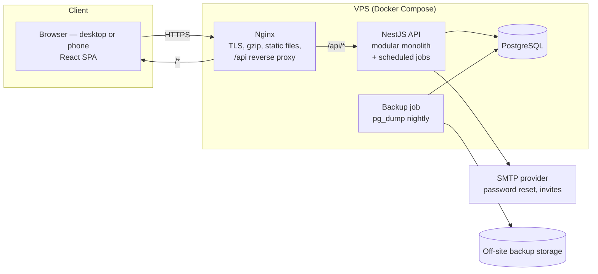

# StockWise — 01. Architecture

Version 0.1 · Phase 1 design · Audience: the two developers, project supervisor

> **Know what you have. Know what you are losing. Know what you need to purchase.**

## 1. Scope of this document

This document explains how StockWise is built and why. Companion documents:

| Doc | Contents |
|---|---|
| 02-data-model.md | ERD, entities, invariants, data types (+ `schema.prisma`) |
| 03-roles-and-use-cases.md | Roles, permission matrix, use cases |
| 04-inventory-intelligence.md | Formulas for velocity, reorder point, reorder quantity, slow-moving, anomalies, valuation |
| 05-api-spec.md | REST endpoints, conventions, error codes |
| 06-frontend.md | Navigation, screens, UI states |
| 07-backlog.md | Phased backlog, MVP cut line, risks, open questions |

## 2. System at a glance



There's one deployable API process, one database and a static frontend. No message broker, no Redis and no microservices in v1. Scheduled jobs run inside the API process with `@nestjs/schedule`.

## 3. Key decisions (ADR summary)

| # | Decision | Why | Revisit when |
|---|---|---|---|
| D1 | **Modular monolith** (NestJS modules with explicit public services) | Two developers; one deploy; transactions span purchases + stock in one DB call | A module needs independent scaling |
| D2 | **Shared-schema multi-tenancy** (`businessId` column) | Cheapest to build and operate; works fine for thousands of SMEs | A large customer needs a dedicated DB |
| D3 | **Ledger + cached balance** for stock (`StockMovement` + `StockLevel`) | Auditable history *and* fast reads; matches the brief's "movements are the source of truth" | — |
| D4 | **Pessimistic row locks** (`SELECT … FOR UPDATE`) on `StockLevel` inside a transaction | Simple and correct under concurrent sales and receipts; Postgres handles this well at SME volumes | Very high write contention on one product |
| D5 | **Zod schemas shared** between frontend and backend (`packages/shared`) | The brief already uses Zod on the frontend; one schema validates both sides and feeds types | — |
| D6 | **JWT access token (15 min, in memory) + rotating refresh token (httpOnly cookie)** | Meets the brief's "JWT with refresh-token handling" while keeping tokens out of `localStorage` (XSS) | — |
| D7 | **Weighted average cost (WAC)** stored on `StockLevel`, snapshotted on each movement | Required by the brief; cheap to maintain incrementally | FIFO needed for compliance |
| D8 | **PDF with `pdfmake`** (pure JS), CSV streamed | No headless Chrome on a small VPS or an 8 GB dev laptop | Pixel-perfect branded reports |
| D9 | **API returns error codes, not sentences**; UI translates | Clean FR/EN localisation | — |
| D10 | **Event-driven alert checks after each stock change + nightly batch jobs** | No queue infrastructure needed; nightly job also self-heals missed checks | Volume needs a queue (BullMQ + Redis) |
| D11 | **Idempotency keys** on "complete sale" and "receive purchase" | Mobile data in Burundi can be unreliable; retries must not double-count stock | — |
| D12 | **Plan entitlements as feature flags** on `Business.plan`; no billing integration in v1 | Pricing must be validated with real businesses first (brief §11) | Paid launch |

## 4. Repository layout

A pnpm workspace monorepo, so the two developers share types and run everything with one command.

```
stockwise/
├─ apps/
│  ├─ api/                     NestJS backend
│  │  ├─ prisma/               schema.prisma, migrations/, seed.ts, sql/
│  │  ├─ src/
│  │  │  ├─ main.ts
│  │  │  ├─ app.module.ts
│  │  │  ├─ common/            guards, decorators, filters, pipes, interceptors
│  │  │  ├─ prisma/            PrismaService, tenant-scoping helpers
│  │  │  ├─ config/            env validation (Zod)
│  │  │  └─ modules/
│  │  │     ├─ auth/  business/  users/  products/  categories/  suppliers/
│  │  │     ├─ warehouses/  inventory/  purchases/  sales/
│  │  │     └─ analytics/  alerts/  reports/  audit/
│  │  └─ test/                 e2e (Supertest) + isolation + concurrency suites
│  └─ web/                     React + Vite frontend
│     └─ src/
│        ├─ app/               router, providers, layout
│        ├─ features/          auth, dashboard, products, inventory, purchases, sales, ...
│        ├─ components/ui/     buttons, tables, dialogs, form fields
│        ├─ lib/               api client, formatters (money/date), permissions
│        └─ locales/           fr/*.json, en/*.json
├─ packages/
│  └─ shared/                  Zod schemas, enums, permission keys, error codes
├─ e2e/                        Playwright tests
├─ docker/                     nginx.conf, Dockerfiles, backup script
├─ docker-compose.yml          local dev: postgres + mailpit
├─ docker-compose.prod.yml
└─ docs/
```

## 5. Backend module map

| Module | Responsibility | Owns tables | Uses |
|---|---|---|---|
| **AuthModule** | Register, login, refresh, logout, password reset, accept invite, switch business | RefreshToken, PasswordResetToken | Users, Business, Audit |
| **BusinessModule** | Business profile, settings, plan entitlements | Business | Audit |
| **UsersModule** | Members, invitations, roles and permissions | BusinessMembership, Invitation, Role, Permission | Audit, Mail |
| **WarehousesModule** | Locations (one default in MVP) | Warehouse | — |
| **CategoriesModule** | Category CRUD/archive | Category | — |
| **SuppliersModule** | Supplier CRUD/archive, supplier purchase history | Supplier | Purchases (read) |
| **ProductsModule** | Product CRUD/archive/search, opening stock | Product | Inventory |
| **InventoryModule** | **Stock engine.** The only writer of StockLevel/StockMovement; adjustments, write-offs, stock counts, reconciliation | StockLevel, StockMovement, ProductBatch, DocumentSequence | Alerts (events), Audit |
| **PurchasesModule** | Purchase lifecycle, receiving (partial/full), supplier returns | Purchase, PurchaseItem | Inventory |
| **SalesModule** | Complete sale, void, customer return, receipts | Sale, SaleItem | Inventory |
| **AnalyticsModule** | Dashboard KPIs, velocity, reorder recommendations, slow movers, valuation | InventorySnapshot | read-only queries |
| **AlertsModule** | Alert evaluation, deduplication, notifications, nightly jobs | Alert, Notification | Analytics |
| **ReportsModule** | CSV/PDF exports | — | Analytics, read queries |
| **AuditModule** | Append-only activity log | AuditLog | — |

**Rule:** modules talk through exported services, never by reaching into another module's tables. The most important instance is that **Purchases and Sales never touch `StockLevel` directly.** They call `InventoryService.applyMovements(tx, lines)` inside their own transaction.

## 6. Request lifecycle and tenant isolation

```
Request
 → Helmet, CORS allow-list, body size limit
 → ThrottlerGuard            (global + stricter on /auth/*)
 → JwtAuthGuard              (verifies access token: sub=userId, bid=businessId)
 → TenantGuard               (loads ACTIVE membership for (userId, bid) → role + permissions;
                              stores {userId, businessId, roleKey, permissions} in request context)
 → PermissionsGuard          (@RequirePermissions('sales.create'))
 → EntitlementGuard          (@RequiresPlan('BUSINESS') for advanced features)
 → ZodValidationPipe         (body, query, params)
 → Controller → Service      (Prisma transaction where needed)
 → AuditService.record(...)  (inside the same transaction for writes)
 → GlobalExceptionFilter     ({ error: { code, message, details } })
```

**Tenant isolation, in layers:**

1. **`businessId` never comes from the client.** It comes from the verified token and the membership check. DTOs don't have a `businessId` field.
2. **Every query is scoped.** Services read the tenant from a request-scoped context (`nestjs-cls`) and include `businessId` in every `where`. Use `findFirst({ where: { id, businessId } })`, never `findUnique({ where: { id } })`, for tenant data.
3. **Guard-rail in development and tests:** a Prisma client extension throws if a query on a tenant model has no `businessId` in its `where`. That catches forgotten scopes early.
4. **Referenced IDs are verified.** When a sale line references `productId`, the service checks that product belongs to the tenant before using it.
5. **Other tenants' records return 404, not 403**, so attackers can't confirm that an ID exists.
6. **Isolation test suite:** seed two businesses, then call every endpoint as business A using business B's IDs. Expect 404 or an empty list. This suite runs in CI.
7. *(Later, defence in depth)* PostgreSQL Row-Level Security with `SET app.business_id` per transaction.

The membership is loaded on every request with a single indexed query. That keeps role changes and suspensions effective immediately, without waiting for tokens to expire.

## 7. The stock engine (InventoryModule)

This is the heart of the system. All stock changes go through one function.

### 7.1 Contract

```ts
interface MovementInput {
  productId: string;
  warehouseId: string;
  type: MovementType;
  quantityChange: Decimal;      // signed: + in, − out
  unitCost?: Decimal;           // required for OPENING_BALANCE / PURCHASE_RECEIPT
  reason?: string;              // required for ADJUSTMENT, WRITE_OFF, returns, voids
  refs?: { purchaseId?, purchaseItemId?, saleId?, saleItemId?, reversalOfId?, documentRef? };
}

// Must be called with a transaction client. Never opens its own transaction.
applyMovements(tx: Prisma.TransactionClient, ctx: TenantCtx, lines: MovementInput[]): Promise<StockMovement[]>
```

### 7.2 Algorithm

```
applyMovements(tx, ctx, lines):
  lines ← sort lines by (productId, warehouseId)                 -- consistent lock order ⇒ no deadlocks
  for each distinct (productId, warehouseId):
      INSERT INTO stock_levels(...) VALUES (..., 0, 0) ON CONFLICT DO NOTHING
      row ← SELECT * FROM stock_levels WHERE productId=$1 AND warehouseId=$2 FOR UPDATE
  for each line:
      before ← row.quantityOnHand
      after  ← before + line.quantityChange
      if after < 0 and not settings.allowNegativeStock:
          throw INSUFFICIENT_STOCK { productId, available: before, requested: |change| }
      if line.quantityChange > 0:                                  -- stock coming in
          inCost ← line.unitCost                                   -- receipt: purchase cost
                   ?? (return: original SaleItem.unitCost)
                   ?? row.averageCost                              -- adjustments in: current WAC
          newAvg ← (before ≤ 0) ? inCost
                   : (before × row.averageCost + change × inCost) / after
      else:                                                        -- stock going out
          inCost ← row.averageCost ; newAvg ← row.averageCost      -- issues don't change WAC
      UPDATE stock_levels SET quantityOnHand=after, averageCost=newAvg,
             version=version+1, lastMovementAt=now() WHERE id=row.id
      INSERT stock_movements(type, quantityChange, quantityBefore=before, quantityAfter=after,
             unitCost=inCost, averageCostAfter=newAvg, userId=ctx.userId, refs…, reason)
      row.quantityOnHand ← after ; row.averageCost ← newAvg
  after commit: emit 'stock.changed' {businessId, productIds}  → AlertsModule (low/out-of-stock)
                emit 'stock.adjusted' {movementIds}             → anomaly check (ADJUSTMENT/WRITE_OFF only)
```

Implementation notes:
- Use Prisma interactive transactions (`prisma.$transaction(async (tx) => …, { timeout: 10_000 })`) with `tx.$queryRaw` for the `FOR UPDATE` select. READ COMMITTED isolation is enough because the row lock serialises writers per product.
- All arithmetic uses `Prisma.Decimal`. Round WAC to 4 decimals and money to 2.
- Events are emitted **after commit** (`@nestjs/event-emitter`, triggered once the transaction resolves). If the process dies in between, the nightly alert job catches up.

### 7.3 How each business operation maps to movements

| Operation | Movement(s) | Notes |
|---|---|---|
| Create product with opening stock | `OPENING_BALANCE +q` @ unit cost | Also used by CSV import |
| Purchase created / ordered | *none* | Brief: never increase stock on order |
| Purchase received (partial or full) | `PURCHASE_RECEIPT +q` per line @ line unit cost | Updates `quantityReceived`; status → PARTIALLY_RECEIVED / RECEIVED |
| Supplier return | `SUPPLIER_RETURN −q` | Linked to purchase item when known |
| Sale completed | `SALE −q` per line | `SaleItem.unitCost` ← WAC at that moment |
| Sale voided (Manager+) | `SALE_VOID +q` per line, `reversalOfId` = original | Only if nothing was returned; sale → VOIDED |
| Customer return | `CUSTOMER_RETURN +q` @ original `SaleItem.unitCost` | Partial allowed; sale → PARTIALLY_RETURNED / RETURNED |
| Manual adjustment / stock count | `ADJUSTMENT ±q` with mandatory reason | Count screen computes `counted − system` per product, one `documentRef` |
| Damaged / expired | `WRITE_OFF −q` with mandatory reason | |
| Transfer (later) | `TRANSFER_OUT −q` + `TRANSFER_IN +q`, same `transferId` | One transaction |

### 7.4 Concurrency guarantees

- Two cashiers sell the last 3 units at the same time: the second transaction waits on the row lock, then sees `before = 0` and gets `INSUFFICIENT_STOCK`.
- A receipt and a sale for the same product run in sequence, and both movements record correct `before`/`after` values.
- **Required test:** fire 20 parallel "sell 1 unit" requests at a product with 10 in stock. Exactly 10 succeed, 10 fail with `INSUFFICIENT_STOCK`, the final balance is 0 and the ledger sum is 0.

### 7.5 Reconciliation

A nightly job (and an Owner-only endpoint) checks invariant I1 for every stock level:
`SELECT … WHERE quantityOnHand <> (SELECT SUM(quantityChange) FROM stock_movements …)`.
Any mismatch raises a CRITICAL alert and is logged. That should never happen, and if it does it means a bug.

## 8. Authentication and session security

| Concern | Design |
|---|---|
| Password hashing | `argon2id` (package `argon2`), min length 8, checked against a small common-password list |
| Access token | JWT (HS256, secret from env), 15 min, claims `sub`, `bid` (active business), `jti`. Kept **in memory** in the SPA |
| Refresh token | 256-bit random, stored **hashed** in `RefreshToken`, sent as `httpOnly; Secure; SameSite=Strict; Path=/api/v1/auth` cookie, 14 days |
| Rotation | Every `/auth/refresh` issues a new refresh token and revokes the old one. Reuse of a revoked token revokes the whole `familyId` (stolen-token detection) |
| CSRF | Refresh cookie is SameSite=Strict + the API checks the `Origin` header on cookie-authenticated routes. All other routes use the Bearer header |
| Business switching | `POST /auth/switch-business` checks membership and issues tokens with the new `bid` |
| Password reset | Single-use token, hashed, 30 min. Same response whether or not the email exists. All sessions revoked on success |
| Invitations | Single-use token, 7 days, bound to email + role |
| Brute force | Throttler: 5 login attempts / min / IP+email; global 100 req/min/user; failed logins audited |
| Transport | HTTPS only (HSTS), Helmet headers, CORS allow-list |

**Email is needed in the MVP.** The brief defers email *notifications*, but password recovery and employee invitations need transactional email. Use `nodemailer` over SMTP. In development, Mailpit in Docker Compose catches every email.

## 9. Authorization

- Permission keys (e.g. `sales.void`) live in `packages/shared` so the frontend can hide buttons and the backend can enforce them. **The backend check is the one that matters.** The UI check is for convenience only.
- System roles are seeded with permission sets (docs/03 §2). Custom roles come later (Pro plan) and reuse the same tables.
- Some rules depend on data, not just permission, and live in services:
  - An Employee's discount must be ≤ `employeeMaxDiscountPercent`.
  - Employees see only their own sales history.
  - A Manager can invite Employees only, not Managers or Owners.
  - The last Owner can't be removed or demoted.
  - Users can't change their own role.

## 10. Alerts, notifications and scheduled jobs

| Trigger | Checks | Alert type |
|---|---|---|
| `stock.changed` event (after any movement) | `available ≤ 0` → OUT_OF_STOCK (CRITICAL); `≤ minStockLevel` → LOW_STOCK (WARNING); otherwise auto-resolve open ones | LOW_STOCK, OUT_OF_STOCK |
| `stock.adjusted` event | Anomaly rules R1–R5 (docs/04 §6) | UNUSUAL_ADJUSTMENT |
| Nightly 01:00 business time | Purchases past `expectedAt` still ORDERED/PARTIAL | PURCHASE_OVERDUE |
| Nightly | Batches expiring within `expiryWarningDays` (if expiry enabled) | EXPIRY_APPROACHING |
| Nightly | Re-evaluate low/out-of-stock for all products (self-healing) | — |
| Nightly | Write `InventorySnapshot`; run reconciliation (§7.5) | — |

- **Deduplication:** `dedupeKey = TYPE:productId:warehouseId`. If an open alert exists, update `lastDetectedAt` and `params`. Otherwise create one and fan out `Notification`s to members whose role has `alerts.view` (UNUSUAL_ADJUSTMENT goes only to `alerts.manage`).
- **Delivery:** the frontend polls `GET /notifications/unread-count` every 60 s with TanStack Query. No websockets in v1.
- Jobs loop over businesses in batches. Each job is idempotent, so running it twice is harmless.

## 11. Reports and exports

- **CSV** is streamed (`csv-stringify`), so large ledgers don't load into memory. UTF-8 with a BOM so Excel opens French accents correctly.
- **PDF** uses `pdfmake` with a shared layout: business name, report title, filters used, generation time, page numbers, and amounts formatted in the business currency and locale.
- Generated synchronously, with a capped date range (e.g. 366 days) and row limit. Every export is audited (`report.export`).

## 12. Localisation, currency and time

- **Frontend:** `react-i18next` with `fr` and `en` namespaces per feature. All UI text goes through `t()`. Language comes from the user preference, then the business default.
- **Backend:** returns `{ code: 'INSUFFICIENT_STOCK', details: { productId, available } }`. PDF/CSV reports are rendered in the business locale with server-side translation files.
- **Money:** `new Intl.NumberFormat(locale, { style: 'currency', currency: business.currency })`. BIF automatically renders with 0 decimals. No hard-coded symbols anywhere.
- **Dates:** stored in UTC, displayed in the business timezone (`date-fns-tz` or `Intl.DateTimeFormat` with `timeZone`). "Today's sales" means 00:00–24:00 in `Africa/Bujumbura`, computed on the server.

## 13. Security checklist (maps to brief §8)

| Requirement | Where |
|---|---|
| Secure password hashing | argon2id (§8) |
| Authentication & authorization | JWT + guards (§6, §8, §9) |
| Role-based permissions | Permission matrix (docs/03), PermissionsGuard |
| Business-level isolation | §6 layers + isolation test suite |
| Server-side validation | Zod pipe on every endpoint; DB CHECK constraints |
| SQL injection | Prisma parameterised queries; `$queryRaw` only with tagged templates, never `$queryRawUnsafe` |
| Rate limiting | `@nestjs/throttler` |
| Secure tokens | §8 (memory + httpOnly cookie, rotation, hashing) |
| Audit logs | AuditModule; append-only trigger |
| HTTPS | Nginx + Let's Encrypt, HSTS |
| Backups & recovery | §15 |
| Not relying on frontend checks | All permission and plan checks enforced in guards |

Also: secrets only in environment variables (never committed), `npm audit` in CI, dependency updates monthly, and no stack traces in production responses.

## 14. Testing strategy

| Layer | Tool | Must cover |
|---|---|---|
| Unit | Jest | WAC calculation, reorder point/quantity, velocity, anomaly rules, discount rules, reference generation |
| Integration / API | Jest + Supertest against a real Postgres (Docker, reset per suite) | Every endpoint's happy path + permission denial; **tenant isolation suite**; **concurrency test** (§7.4); purchase receive → stock ↑; sale → stock ↓; void/return reversals; ledger reconciliation after a random sequence of operations |
| Frontend | React Testing Library + Vitest | Forms (validation messages), permission-based rendering, money/date formatting, sale cart totals |
| End-to-end | Playwright | Register → add product → receive purchase → sell → see stock + movement history → low-stock alert → export report |

Rule from the brief: **a feature isn't "done" until its tests pass in CI.**

## 15. Environments and deployment

**Local development (8 GB laptop friendly):** `docker compose up` starts only Postgres 16 and Mailpit. The API (`pnpm --filter api dev`) and web (`pnpm --filter web dev`) run natively for fast reloads. Total RAM is well under 2 GB.

**Production (single VPS, 2 vCPU / 4 GB is plenty for the pilot):**

```
docker-compose.prod.yml
  nginx      ← ports 80/443, Let's Encrypt certificates (certbot), serves web build, proxies /api
  api        ← node:22-alpine, runs `prisma migrate deploy` then starts
  postgres   ← postgres:16, volume on disk, not exposed publicly
  backup     ← cron: pg_dump -Fc nightly → encrypted → off-site (S3-compatible bucket)
```

- **Backups:** keep 7 daily, 4 weekly and 6 monthly copies. **Do a restore drill before the pilot and monthly after**, restoring into a scratch container and running the reconciliation query. A backup you've never restored from isn't really a backup.
- **CI (GitHub Actions):** lint, type-check and test (with a Postgres service container) on each PR, plus a build check. Deploy by manual workflow: SSH, `git pull`, `docker compose up -d --build`.
- **Observability:** `GET /api/v1/health` (DB ping), structured JSON logs (`nestjs-pino`), an external uptime monitor, and an error log reviewed weekly during the pilot.
- **Hosting region:** choose the provider region with the best measured latency from Bujumbura (test before buying).

## 16. Out of scope for v1

Full accounting, credit sales and customer accounts, POS hardware beyond keyboard-wedge barcode scanners (these work out of the box because they "type" into the search box), offline mode, native mobile apps, payment/billing integration, multi-location transfers (data model ready), email/SMS alert delivery (after the core works), custom roles, and FIFO costing.
