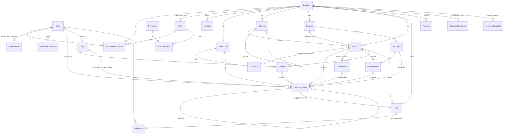

# StockWise — 02. Data model and ERD

Version 0.1 · Phase 1 design · Source of truth: `apps/api/prisma/schema.prisma` + `apps/api/prisma/sql/integrity_guards.sql`

## 1. Design principles

1. **Shared database, shared schema, `businessId` on every business-owned row.** That's the simplest multi-tenant model that works for a two-person team, and it's how most SME SaaS products start. Isolation is enforced in the application layer (see 01-architecture §6), with tests that prove it.
2. **The ledger is the truth.** `StockMovement` is an append-only ledger. `StockLevel` is a cached balance per product per warehouse, updated in the *same transaction* as each movement. There is no `Product.quantity` column, so stock can't be edited directly.
3. **Warehouse-ready from day one.** Every stock row is keyed by `(productId, warehouseId)`. The MVP creates one default warehouse per business and hides the selector in the UI.
4. **Snapshots on documents.** Sale lines store the price charged *and* the weighted-average cost at the time of sale (`SaleItem.unitCost`), so margin reports stay correct after prices change.
5. **Archive, don't delete.** Products, categories, suppliers and warehouses use `archivedAt`. Documents (sales, purchases) are never deleted; they change status.
6. **No translated text in the database.** Alerts and notifications store a `type` + `params` (numbers, IDs). The frontend renders them in French or English.

## 2. Entity-relationship diagram



## 3. Entities at a glance

| Group | Entity | Purpose | Key constraints |
|---|---|---|---|
| Identity | `User` | A person; can belong to several businesses | `email` unique (lower-cased) |
| | `RefreshToken` | Rotating refresh-token sessions (hash only) | `tokenHash` unique; `familyId` for reuse detection |
| | `PasswordResetToken` | Single-use, 30-min reset links (hash only) | `tokenHash` unique |
| Tenancy | `Business` | The tenant: currency, locale, timezone, plan, settings | — |
| | `BusinessMembership` | User ↔ Business with a role | unique `(businessId, userId)` |
| | `Invitation` | Pending email invite with role | `tokenHash` unique |
| Access | `Role`, `Permission`, `RolePermission` | System roles seeded with permission keys; custom roles later | unique `(businessId, key)` + partial unique for system roles |
| Catalogue | `Warehouse` | Storage location; one default in MVP | unique `(businessId, code)`; one `isDefault` per business |
| | `Category` | Optional 1-level hierarchy | unique `(businessId, name)` |
| | `Supplier` | Contact info + `leadTimeDays` | unique `(businessId, name)` |
| | `Product` | Catalogue item, prices, thresholds, reorder settings. **No quantity column.** | unique `(businessId, sku)`, `(businessId, barcode)` |
| Inventory | `StockLevel` | Balance + weighted average cost per product × warehouse | unique `(productId, warehouseId)` |
| | `StockMovement` | Append-only ledger row | trigger blocks UPDATE/DELETE; `after = before + change` CHECK |
| | `ProductBatch` | Optional expiry/batch tracking (Phase 5+) | — |
| | `DocumentSequence` | Per-year reference counters (`SAL-2026-000123`) | PK `(businessId, kind, year)` |
| Documents | `Purchase`, `PurchaseItem` | Purchase orders and partial/full receipts | unique `(businessId, reference)`; `0 ≤ received ≤ ordered` |
| | `Sale`, `SaleItem` | Completed sales, voids, returns | unique `(businessId, reference)`, `(businessId, idempotencyKey)` |
| Signals | `Alert` | Deduplicated business condition | one non-resolved alert per `dedupeKey` |
| | `Notification` | Per-user inbox | — |
| | `AuditLog` | Who did what (before/after JSON) | append-only |
| | `InventorySnapshot` | Nightly closing totals for trend charts | unique `(businessId, warehouseId, date)` |

The brief lists 18 required entities. All of them are here. The extra ones (`RefreshToken`, `PasswordResetToken`, `Invitation`, `RolePermission`, `ProductBatch`, `DocumentSequence`, `InventorySnapshot`) are each needed by a feature the brief asks for.

## 4. Invariants the system guarantees

| # | Invariant | Enforced by |
|---|---|---|
| I1 | For each `(product, warehouse)`: `StockLevel.quantityOnHand = Σ StockMovement.quantityChange` | Stock engine writes both in one transaction; nightly reconciliation job + test |
| I2 | Each movement: `quantityAfter = quantityBefore + quantityChange`, and `quantityChange ≠ 0` | DB CHECK constraints |
| I3 | Movements are never updated or deleted | DB trigger; no API endpoint exists |
| I4 | A movement is reversed at most once | `reversalOfId` unique |
| I5 | Stock never goes below zero (unless the business enables `allowNegativeStock`) | Stock engine check under row lock |
| I6 | Stock rises only when goods are *received*, not when a purchase is ordered | Only `POST /purchases/:id/receive` creates `PURCHASE_RECEIPT` movements |
| I7 | `0 ≤ PurchaseItem.quantityReceived ≤ quantityOrdered`; `0 ≤ SaleItem.quantityReturned ≤ quantity` | DB CHECKs + service validation |
| I8 | Every row a request touches belongs to the caller's business | Tenant context + scoped queries + isolation test suite |
| I9 | A retried "complete sale" request never creates two sales | `Idempotency-Key` header → unique `(businessId, idempotencyKey)` |
| I10 | References are unique and gap-tolerant per business per year | `DocumentSequence` row lock in the same transaction |

## 5. Data types and units

- **Quantities** use `Decimal(14,3)`. Rice by the kg and fuel by the litre are common in Burundian retail. If `allowFractional = false`, the API rejects non-integer quantities for that product.
- **Money** is `Decimal(18,2)` for amounts and `Decimal(18,4)` for unit costs. BIF has no minor unit in practice, but other currencies do, and weighted average cost produces fractions. Format with `Intl.NumberFormat`, never by hand.
- In TypeScript, Prisma returns `Decimal` objects (decimal.js). **Never convert to JS `number` for arithmetic.** Do the maths with `Decimal` and serialise as strings in JSON.
- **IDs** are UUIDs, so they're safe to expose in URLs and can't be guessed or enumerated across tenants. `StockMovement.seq` gives a strict insert order for ledgers.
- **Time** is stored as `timestamptz` (UTC). The business timezone (default `Africa/Bujumbura`) defines "today", "this month" and the nightly jobs.

## 6. Business settings (JSON, validated with Zod)

```ts
// packages/shared/src/business-settings.ts
export const BusinessSettings = z.object({
  allowNegativeStock: z.boolean().default(false),
  employeeMaxDiscountPercent: z.number().min(0).max(100).default(5),
  analysis: z.object({
    salesWindowDays: z.number().int().min(7).max(365).default(30),
    safetyStockDays: z.number().min(0).max(60).default(3),
    reviewPeriodDays: z.number().int().min(1).max(90).default(14),
    slowMovingDays: z.number().int().min(14).max(365).default(60),
    deadStockDays: z.number().int().min(30).max(730).default(90),
  }).default({}),
  anomaly: z.object({
    maxDaysOfSales: z.number().default(7),          // rule R1
    valueThreshold: z.number().default(100_000),    // rule R2, business currency
    shareOfStockPercent: z.number().default(20),    // rule R3
    modifiedZThreshold: z.number().default(3.5),    // rule R4
    perUserDailyNegativeCount: z.number().default(5) // rule R5
  }).default({}),
  expiryWarningDays: z.number().int().default(30),
});
```

## 7. Notes for the implementers

- **Seeding:** create the `Permission` rows and the three system `Role`s with their permission sets (docs/03 §2) in `prisma/seed.ts`. Seeding must be idempotent (upserts).
- **Registration transaction:** one transaction creates `User` → `Business` → `Warehouse(isDefault)` → `BusinessMembership(OWNER)`.
- **Opening stock:** creating a product with an initial quantity writes an `OPENING_BALANCE` movement at the given unit cost. That isn't a direct write to the quantity.
- **Where each guard lives:** partial unique indexes (one default warehouse, one open alert per condition, unique system-role keys) and the trigram search indexes are declared in `schema.prisma` (Prisma 7 preview features `partialIndexes` and `postgresqlExtensions`), so Prisma never sees them as drift. Triggers and CHECK constraints can't be expressed there. They live in `prisma/sql/integrity_guards.sql`, which `pnpm db:init` installs as its own migration right after the initial one. The SQL uses quoted camelCase column names because the schema maps table names, not column names.
- **Composite tenant FKs (optional hardening):** you can make the database itself reject cross-tenant references, e.g. a `SaleItem` pointing at another business's product. You'd add `@@unique([id, businessId])` on parents and composite relations on children. That's left out of v0.1 to keep the Prisma models simple. The service layer validates ownership instead, and the isolation tests cover it.
