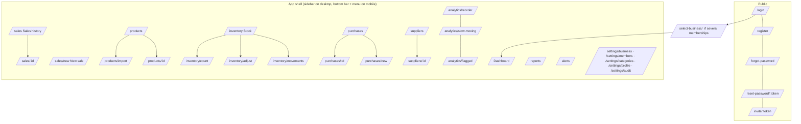

# StockWise — 06. Frontend: navigation and main screens

Version 0.1 · Phase 1 design · Stack: React + TypeScript + Vite + Tailwind + React Router + TanStack Query + React Hook Form/Zod + Recharts + react-i18next

## 1. Structure and patterns

```
apps/web/src/
├─ app/            router.tsx, providers.tsx (QueryClient, i18n, Auth), AppLayout, ProtectedRoute
├─ features/
│  ├─ auth/        LoginPage, RegisterPage, ForgotPasswordPage, ResetPasswordPage, AcceptInvitePage, SelectBusinessPage
│  ├─ dashboard/   DashboardPage, kpi cards, charts
│  ├─ products/    ProductsPage, ProductDetailPage, ProductFormDialog, ImportPage
│  ├─ inventory/   StockPage, MovementsPage, AdjustmentPage, StockCountPage, WriteOffDialog
│  ├─ purchases/   PurchasesPage, PurchaseFormPage, PurchaseDetailPage, ReceiveDialog
│  ├─ sales/       NewSalePage (POS), SalesPage, SaleDetailPage, Receipt
│  ├─ suppliers/   SuppliersPage, SupplierDetailPage
│  ├─ analytics/   ReorderPage, SlowMovingPage, FlaggedAdjustmentsPage, ValuationPage
│  ├─ reports/     ReportsPage
│  ├─ alerts/      AlertsPage, NotificationBell
│  └─ settings/    BusinessSettingsPage, MembersPage, CategoriesPage, ProfilePage, AuditLogPage
├─ components/ui/  Button, Input, Select, DataTable, Dialog, ConfirmDialog, EmptyState, ErrorState,
│                  Skeleton, StockBadge, Money, Quantity, DateTime, Pagination, FilterBar
├─ lib/            api.ts (fetch wrapper + refresh), queryKeys.ts, format.ts, permissions.ts
└─ locales/        fr/{common,products,sales,…}.json · en/…
```

- **Server state:** TanStack Query only. Each feature has `api.ts` (calls) and `queries.ts` (hooks). Query keys are namespaced by business ID, so switching business never shows stale data from another tenant.
- **Auth:** the access token is held in memory (React context). On a 401 `TOKEN_EXPIRED`, `api.ts` calls `/auth/refresh` once (one shared promise for parallel requests) and retries. On page reload, a silent `/auth/refresh` restores the session from the cookie.
- **Permissions:** `GET /me` returns `permissions[]`. `<Can perm="sales.void">` and `useCan()` hide or disable UI. Routes are guarded too. This is UX only, because the API enforces everything.
- **Forms:** React Hook Form + the **same Zod schemas** from `packages/shared`. Server `VALIDATION_ERROR` details map back onto fields.
- **Formatting:** `<Money value currency />`, `<Quantity value unit />` and `<DateTime value />` use `Intl` with the business locale, currency and timezone. Never format inline.
- **Mutations** for sales and receipts generate an `Idempotency-Key` once per attempt (kept across retries) and disable the submit button while pending.

## 2. Navigation map



**Sidebar (in order), with visibility by permission:**

| Item | Route | Visible with |
|---|---|---|
| Dashboard | `/` | all |
| New sale *(primary button)* | `/sales/new` | sales.create |
| Sales | `/sales` | sales.create |
| Products | `/products` | products.view |
| Inventory | `/inventory` | products.view |
| Purchases | `/purchases` | purchases.view |
| Suppliers | `/suppliers` | suppliers.view |
| Analytics | `/analytics/reorder` | analytics.view |
| Reports | `/reports` | reports.export |
| Alerts | `/alerts` (+ bell in header) | alerts.view |
| Settings | `/settings/…` | profile for all; other tabs by permission |

**Mobile bottom bar:** Dashboard · New sale · Products · Alerts · More. Employees mostly work on phones, so their key flows (sell, receive, check stock) must be comfortable at 360 px width.

**Header:** business name (switcher if several), language toggle FR/EN, notification bell with unread count, user menu.

## 3. Main screens

### 3.1 Dashboard (`/`)
- **Owner/Manager:** date-range picker (Today, 7 days, 30 days, This month, Custom). KPI cards: Today's sales, Period sales, Inventory value, Low-stock count, Out-of-stock count, Pending purchases. Charts (Recharts): sales trend (line), inventory value trend (area), top products (horizontal bar). Lists: Reorder suggestions (top 5 with "Why?"), Slow movers (top 5), Recent movements (10).
- **Employee:** my sales today (count), low-stock list, alerts, quick actions (New sale, Receive goods).
- Each card handles **loading** (skeleton), **empty** ("No sales yet — record your first sale") and **error** (retry button).

### 3.2 New sale / POS (`/sales/new`)
- Left/top: a search box that's **autofocused**. It accepts typed name, SKU or a barcode scanner (Enter → `/products/lookup`). Results show name, price and available quantity with a stock badge.
- Right/bottom: cart lines with a quantity stepper (decimal input if `allowFractional`), line discount (limited for Employees, with an inline message when exceeded), line total, remove.
- Footer: subtotal, discount, **total**, payment method buttons, amount tendered → change due (cash), **Complete sale** button.
- After success: receipt view (print 80 mm / A4), "New sale" button, and stock warnings for lines that went low.
- `INSUFFICIENT_STOCK`: highlight the line, show "Only 3 available", keep the cart.
- Keyboard: `/` focuses search, `F2` completes, `Esc` clears search.

### 3.3 Products (`/products`, `/products/:id`)
- Table: image, name, SKU, category, on-hand + unit, **stock badge** (OK green / Low amber / Out red, always with a text label too, not colour alone), selling price, cost (cost roles). Filters: search, category, status, supplier, archived. Mobile: card list.
- Create/edit dialog: sections Basic, Pricing, Stock settings (min, target, pack size, lead time override), Opening stock (create only). The quantity is **read-only** on edit, with a link "Adjust stock".
- Detail page tabs: **Overview** (stock per warehouse, velocity 7/30/90, reorder explanation card), **Movements** (ledger table: date, type, change, before → after, user, reason, document link, flag icon), **Purchases**, **Sales**.

### 3.4 Inventory (`/inventory/*`)
- **Stock:** all products with on-hand, status and value (cost roles), plus summary chips (Out: 4 · Low: 12).
- **Movements:** global ledger with filters (type, product, user, date, flagged only). Export CSV.
- **Adjust:** product picker → current quantity → new quantity or ± → reason select (Count correction, Found, Theft/loss, Data entry error, Other) + note → confirm dialog showing value impact.
- **Stock count:** choose category/all → table with system quantity hidden by default (blind count option) → enter counted → review differences → confirm.
- **Write-off:** dialog from product row or inventory page.

### 3.5 Purchases (`/purchases/*`)
- List with status tabs: Draft · Ordered · Partially received · Received · Cancelled.
- Form: supplier select (shows lead time) → line editor (product, qty, unit cost pre-filled with last cost, line total) → total → Save draft / Mark as ordered.
- Detail: header with status timeline, lines with ordered/received/remaining, **Receive goods** button → dialog with "receive all remaining" default, per-line editable quantities, then confirm. Movement list below. Actions: Cancel, Supplier return, Print PO.

### 3.6 Suppliers (`/suppliers/*`)
- List + detail (contact, lead time, products, purchase history, open orders).

### 3.7 Analytics
- **Reorder (`/analytics/reorder`):** grouped by supplier; columns: product, on hand, on order, avg daily sales, reorder point, suggested qty (editable), confidence badge, **Why?** (expands the plain-language explanation from 04 §6). Select lines → "Create purchase orders".
- **Slow-moving:** table sorted by capital tied up; filter SLOW / DEAD.
- **Flagged adjustments:** movement, user, rules fired (as readable chips), value; Acknowledge with note.

### 3.8 Reports (`/reports`)
- Card per report type → filter form (date range, category, product, supplier, user) → Download PDF / CSV buttons.

### 3.9 Alerts (`/alerts`) and bell
- Tabs Open / Acknowledged / Resolved; filter by type; each alert links to its product, purchase or movement. The bell dropdown shows the latest 10 notifications plus "Mark all read".

### 3.10 Settings
- **Business:** profile, currency, timezone, language, employee discount limit, analysis and anomaly parameters (with short help text explaining each).
- **Members:** members table (role, status, last login), invite dialog, pending invitations.
- **Categories**, **Profile** (name, language, password, sign out everywhere), **Audit log** (Owner).

## 4. UX rules (from brief §9)

- **Confirmation dialogs** for void, return, cancel purchase, adjustments, write-offs, removing members and role changes. Show *what will happen to stock*.
- **States everywhere:** skeleton on load, helpful empty state with a call to action, and an error state with retry. Never a blank screen.
- **Accessibility:** labelled inputs, visible focus, keyboard-operable dialogs, contrast AA, status not conveyed by colour alone.
- **Responsive:** tables become card lists under 768 px, and dialogs become full-screen sheets on mobile.
- **Restraint:** no decorative animation. Only short transitions for dialogs and toasts.
- **Language:** all strings in `locales/fr` and `locales/en`. French is the default for Burundi. Check that long French labels don't break buttons.

## 5. UI prototypes (Phase 1 deliverable)

Before coding the screens, prototype the five that carry the pilot: **Dashboard, New sale, Product detail (with movements), Receive goods, Reorder recommendations**. Low-fidelity is enough. Validate them with one real shopkeeper before Phase 2 ends.
